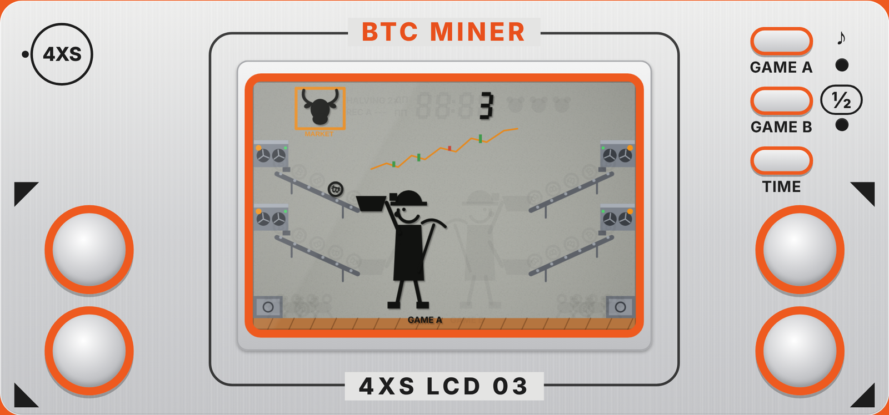
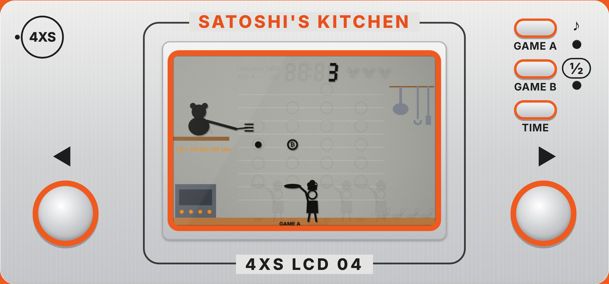
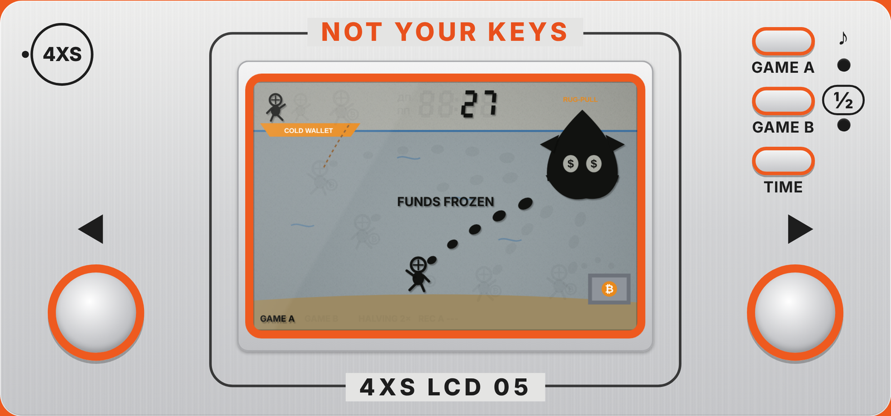
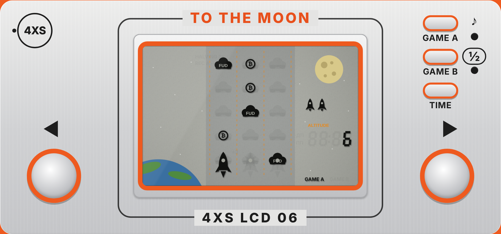

# Igra Modernaya — 4XS Pocket LCD

**▶ Play: [im.4xs.dev](https://im.4xs.dev)**

Classic pocket-LCD handheld games, reimagined with a Bitcoin theme and played full-screen on your phone.
The look and feel of a 1980s LCD handheld: grey reflective LCD, segments that cast a shadow, a printed
colour backdrop, round rubber buttons, piezo beeps, a power-on segment test and a clock with ДП/ПП.
All games, characters and artwork are original.

| Game | URL | Controls | Idea |
|---|---|---|---|
| **BTC MINER** | [im.4xs.dev/btc](https://im.4xs.dev/btc) | 4 corner buttons | A miner catches ₿ coins rolling down from four ASIC miners |
| **SATOSHI'S KITCHEN** | [im.4xs.dev/kitchen](https://im.4xs.dev/kitchen) | ◀ ▶ | A chef flips coins in a pan; every catch splits the coin until it is 1 sat |
| **NOT YOUR KEYS** | [im.4xs.dev/keys](https://im.4xs.dev/keys) | ◀ ▶ | A hodler dives to a seabed vault while a Rug-Pull Squid tries to freeze the funds |
| **TO THE MOON** | [im.4xs.dev/moon](https://im.4xs.dev/moon) | ◀ ▶ | A rocket dodges falling FUD clouds and grabs bitcoins on the way up |

## Features

- **Landscape only, like the hardware** — portrait shows a "rotate your phone" screen with Add-to-Home-Screen help.
- **GAME A / GAME B / TIME** — two speeds, and a clock/record display with a self-playing demo when idle.
- **HALVING (½ button)** — 2× speed and 2× rewards in any game.
- **World Top 5** — every score that makes the top 5 per game and mode asks for 3-letter initials.
- **Czech or English** — picked automatically from the phone's language.
- **Home Screen app** — add it from Safari/Chrome for a full-screen app without browser bars.
- **Sound + haptics** — square-wave piezo beeps (play even with the iPhone silent switch on) and a button tick.
- **Admin dashboard** (`/imadmin`, Cloudflare Access) — players, countries, devices, games, Top 5 moderation.

## Documentation

- [Games & rules](docs/games.md)
- [Controls](docs/controls.md)
- [Top 5, records & admin dashboard](docs/top5-and-admin.md)
- [Architecture & hosting](docs/architecture.md)
- [Design](design/README.md) — hardware face, LCD rendering, game engines, sound

This repository contains documentation and screenshots only.

---

Made by **Pavel Kotyza** · [4xs.dev](https://4xs.dev) · [Ko-fi](https://ko-fi.com/pavelk)
