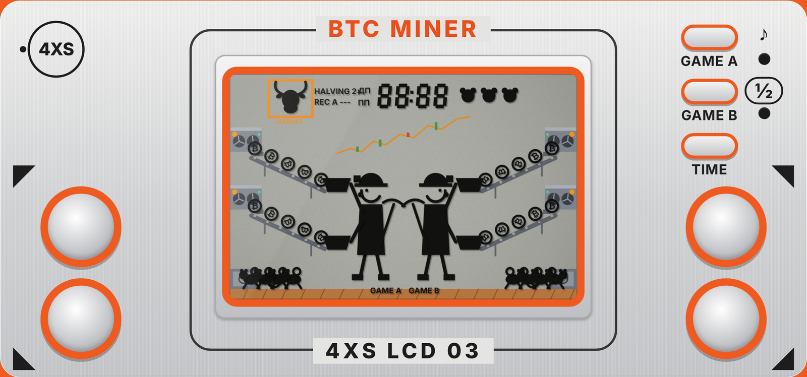
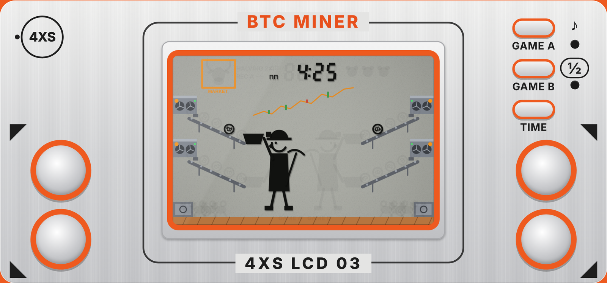
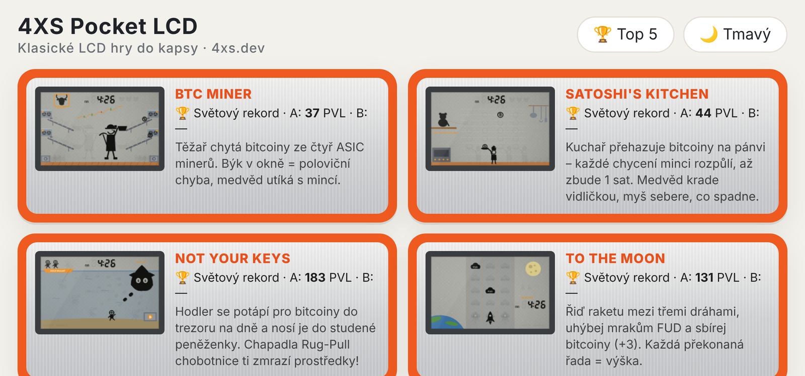

# Design — 4XS Pocket LCD

Goal: an LCD handheld you could believe sits in your hand — the *feel* of a 1980s pocket game,
with original Bitcoin-themed games and artwork.

*Power-on: every segment lights for ~1.3 s, exactly like inserting batteries.*

## 1. Hardware face

The device face is laid out in **design units, height 820**, then scaled to the phone.
The width stretches between 1320 and 1900 units with the screen's aspect ratio, so the face always
fills a landscape phone edge to edge (inside the safe area). Left controls anchor to the left edge,
right controls to the right edge, the screen stays centred.

| Element | Position / size (design units) |
|---|---|
| Logo ring "4XS" (also = back) | left 60, top 44, Ø 124 |
| Frame line with title & model label | centred, 930 × 700, top 62, radius 46 |
| Title | centred on the top frame line, 50 px, letter-spacing 6 |
| Bezel + LCD | centred, bezel 820 × 574 at top 118, LCD 760 × 494 (= 400 × 260 × 1.9) |
| Model label "4XS LCD 0x" | centred on the bottom frame line |
| GAME A / GAME B / TIME pills | right 150, top 52 / 170 / 288, 124 × 56, labels under each |
| ♪ (sound) and ½ (HALVING) + lamps | right 64–80, top 48–232 |
| 4-corner layout | Ø 176 buttons at top 404 / 604, corner triangles ◤ ◣ ◥ ◢ |
| ◀ ▶ layout | Ø 190 buttons at top 520, arrows above |

### Shells

| Shell | Outer | Face | Buttons | Used by |
|---|---|---|---|---|
| **btc** | orange `#ee5a1f` | brushed silver (1 px repeating gradient over `#f1f1f0 → #c6c7ca`) | white domes with a 16-unit orange ring | all current games |
| silver | — | warm silver `#dcd9d2` | dark grey domes | (earlier prototypes) |
| red | red `#c8372f` | gold `#dccfa6` | red domes | (earlier prototypes) |

Pressed state: buttons move 5 units down and their drop shadow collapses. Every press gives a haptic tick.

## 2. The LCD

Logical canvas **400 × 260**, scaled by `devicePixelRatio` (up to 3×). Three layers, painted every frame:

1. **Reflector** — grey `#a9aba3` with a 64 px texture: a 1 px checker at 3.5 % black plus random grain,
   and a soft radial vignette (lighter centre, darker edges).
2. **Printed backdrop** — coloured artwork that never changes (rigs, trays, kitchen, sea, Moon…),
   slightly desaturated like ink under the glass.
3. **Segments** — every sprite position is drawn in every frame:
   - **off**: `rgba(17,18,16,0.045)` — barely visible "ghosts", as on real LCDs;
   - **on**: `#111210` with a **drop shadow** (offset 1.1 / 1.4 px × scale, blur 0.9) — the segment
     floats above the reflector; this shadow is the single biggest realism cue.
4. **Glass** — a diagonal glare (16 % → 5 % white, hard edge at 33 %) and a dark inner rim.

Seven-segment digits: segment thickness 27 % of width, slanted 8 %, colon between the hour pairs,
ДП/ПП (AM/PM) indicators — the clock is 12-hour, as on the originals.

## 3. Game engines

All games advance on a **tick**, not continuous animation:

| Engine | Games | Tick rule |
|---|---|---|
| Catcher | BTC MINER | one tray moves per tick, in rotation (gives the rhythm); 4 positions |
| Juggler | SATOSHI'S KITCHEN | one column moves per tick; coins rise to a column-specific height and fall |
| Diver | NOT YOUR KEYS | 1–2 tentacles step per tick; the player moves freely between 6 positions |
| Lane dodger | TO THE MOON | everything scrolls one row per tick; a guaranteed safe lane |

Shared: GAME A / B base speed, speed-up with score, HALVING (`interval / 2`, points × 2),
3 misses or lives with restores at 200 / 500, a self-playing demo (autopilot) behind the clock.

## 4. Sound

Square-wave Web Audio beeps imitate a piezo speaker:

| Event | Sound |
|---|---|
| Tick | short tone, pitch per tray/column (1047–1397 Hz) |
| Catch | 2093 Hz blip |
| Bank / cash-out | rising three-note arpeggio |
| Miss | alternating 880 / 1175 Hz ×8 |
| Game over | falling four notes |

iOS: audio unlocks on the first touch-end and uses `navigator.audioSession.type = 'playback'`
so the silent switch doesn't mute the game.

## 5. Type & UI chrome

- System font stack (SF / Segoe / Roboto), heavy weight for face labels.
- Home page: light theme by default with a dark toggle; 2×2 grid that fits above the fold in landscape.
- Czech / English text chosen from the device language.

## 6. Originality

The project borrows the *genre* — segment LCD, printed backdrop, A/B/TIME buttons, tick rhythm.
Characters, scenes, names and the device face are original designs for 4XS Pocket LCD.
