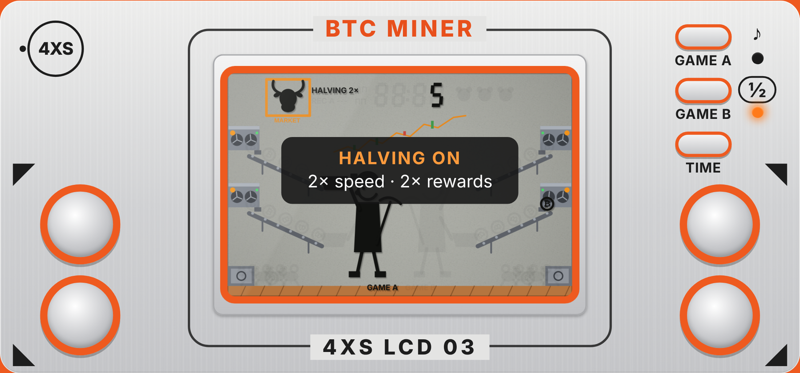
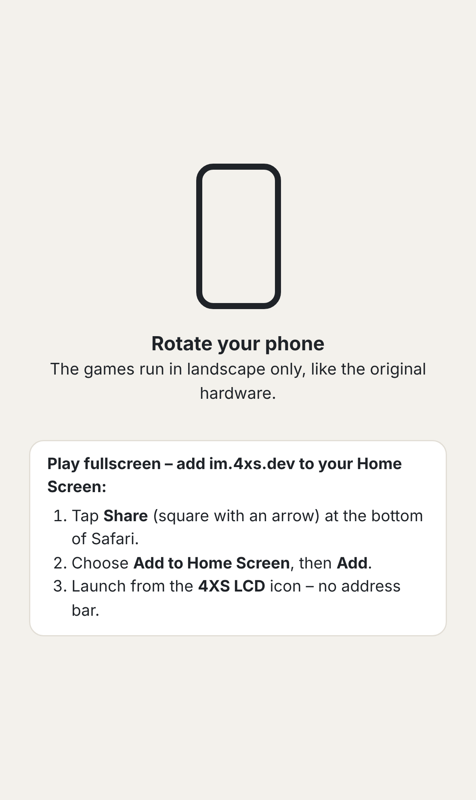
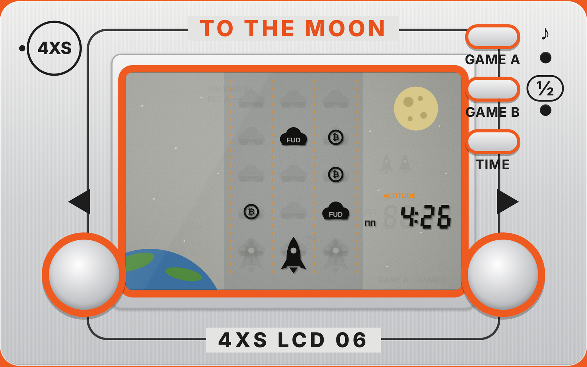

# Controls

## Phone (landscape)

The device face *is* the controller — tap the round buttons like on the real thing.

| Button | Action |
|---|---|
| Big round buttons | move (4 corners in BTC MINER, ◀ ▶ in the other games) |
| **GAME A / GAME B** | start a game at normal / faster speed |
| **TIME** | when idle: clock → record A → record B |
| **♪** | sound and haptics on/off |
| **½** | HALVING — 2× speed, 2× rewards (lamp glows orange, "HALVING 2×" on the LCD) |
| **4XS** logo | back to the game list |

Portrait shows a rotate screen with Home Screen instructions:

### Full screen on iPhone

iOS browsers can't hide their bars for web pages, so use **Add to Home Screen**:
Safari → Share → *Add to Home Screen* → launch from the **4XS LCD** icon. It opens without any browser UI.

## Keyboard (desktop)

| Key | Action |
|---|---|
| `Q` `A` `P` `L` | BTC MINER: top-left, bottom-left, top-right, bottom-right |
| `←` `→` `↑` `↓` | BTC MINER: arrows work as a 2-axis stick (←/→ side, ↑/↓ row) · other games: ← → |
| `1` / `2` | GAME A / GAME B |
| `T` | TIME |
| `H` | HALVING |

