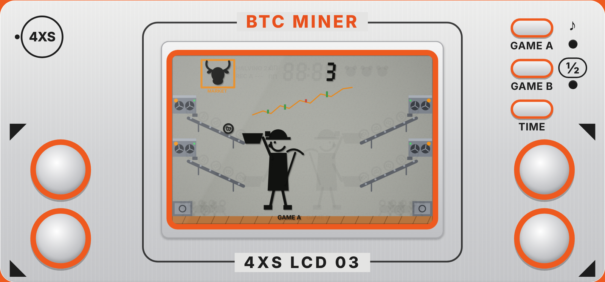
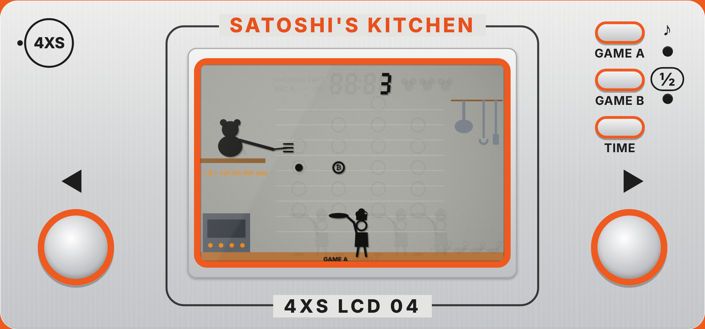
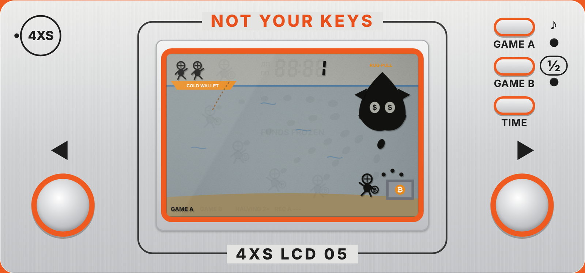
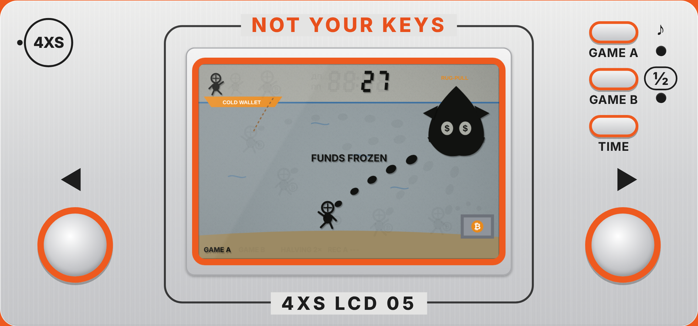
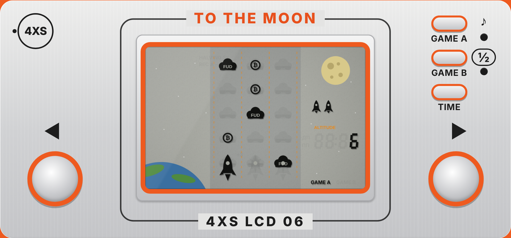

# Games & rules

All games share the same handheld conventions:

- **GAME A** = normal speed, **GAME B** = faster start. Both speed up as the score grows.
- **3 misses / 3 lives** end the game. Misses (or lives) are restored at **200** and **500** points.
- **HALVING (½)** doubles the speed *and* the points (see [controls](controls.md)).
- When idle, the game plays itself behind the clock. **TIME** cycles clock → record A → record B.
- Scores that make the world **Top 5** ask for initials (see [Top 5](top5-and-admin.md)).

---

## BTC MINER — `/btc`

Four ASIC miners (top-left, bottom-left, top-right, bottom-right) roll ₿ coins down cable trays.
Move the miner's bucket to the right corner before a coin drops.

| Event | Result |
|---|---|
| Coin caught | +1 |
| Coin dropped | miss — the coin falls and a bear runs off with it |
| Bull visible in the MARKET window | a miss counts only ½ |

Coins move **one tray at a time, in rotation**, each tray with its own tone — the classic LCD rhythm.
More coins are in play as the score climbs.

## SATOSHI'S KITCHEN — `/kitchen`

A chef with a pan moves under four columns. Coins fly up and fall back; be under each one when it lands.

| Event | Result |
|---|---|
| Catch | +1 and the coin is **split smaller** (₿ → … → 1 sat) |
| Catch a 1-sat coin | +5 — the sat is cashed out and a fresh ₿ is tossed up |
| Drop | miss — a mouse takes what falls |
| Bear on the shelf | grabs a coin with a fork and holds it at the top for a while |

## NOT YOUR KEYS — `/keys`

The hodler climbs down from the **COLD WALLET** boat to a ₿ vault on the seabed and carries coins back.
The **Rug-Pull Squid** extends five tentacles one segment at a time — one of them guards the vault.

| Event | Result |
|---|---|
| Grab at the vault | +1 (repeatable while it is safe) |
| Back on the boat with the coin | +3 |
| Fully extended tentacle reaches the diver | **FUNDS FROZEN** — a life is lost together with the carried coin |

## TO THE MOON — `/moon`

A rocket switches between three lanes while FUD clouds scroll down.

| Event | Result |
|---|---|
| Row of clouds passed | +1 altitude |
| ₿ coin caught | +3 |
| FUD cloud hit | rocket lost (3 rockets) |

Every generated layout is **always solvable**: a "safe lane" runs through every row and only shifts
by one lane into a lane that is also open in the row above. From 60 points some rows hold two clouds,
from 120 points rows come back to back.
