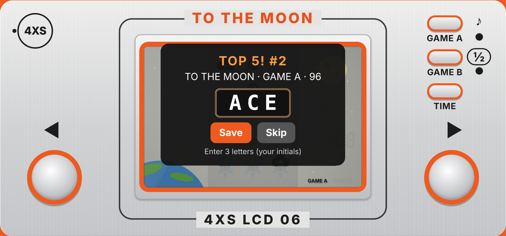
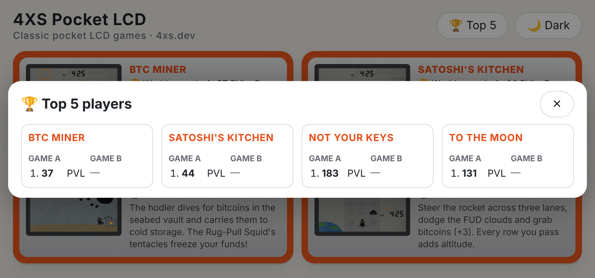
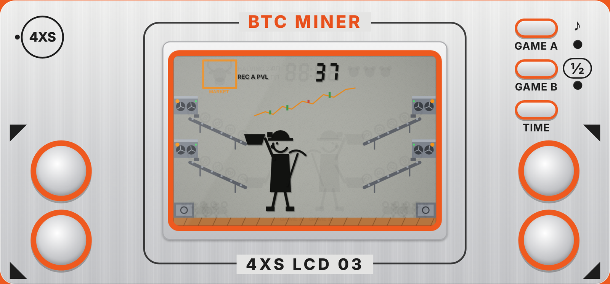
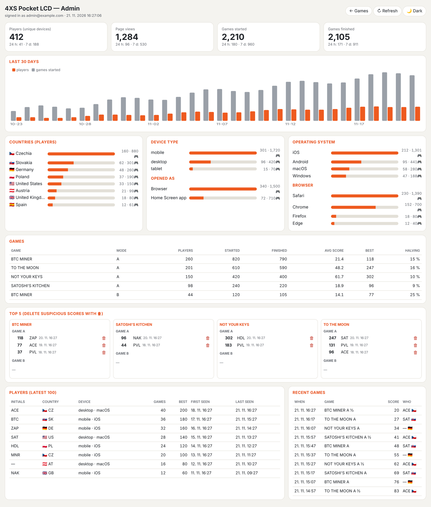

# Top 5, records & admin dashboard

## World Top 5

The server keeps the **best 5 scores per game and mode** (GAME A / GAME B). Ties go to whoever got there first.

When a game ends with a score that makes the list, a dialog asks for **3 letters** (initials are remembered):

| Entering initials | Saved |
|---|---|
|  |  |

- A new #1 shows **NEW WORLD RECORD!**, other places show **TOP 5! #n**.
- The home page shows each game's #1; the **🏆 Top 5** button opens all lists.
- On the device, **TIME** cycles clock → record A → record B (`REC A PVL` beside the score).

| Top 5 overlay | Record on the LCD |
|---|---|
|  |  |

HALVING games count toward records (2× faster *and* 2× points).

## Admin dashboard — `/imadmin`

Protected by **Cloudflare Access** (Zero Trust, one-time PIN by email) for a short list of admin emails.
The Worker additionally verifies the Access JWT (signature, audience, expiry, email allow-list),
so a misconfigured Access app still cannot expose the data.

*Screenshot with sample data.*

- **Overview** — players (unique devices), page views, games started/finished; all-time, 24 h, 7 days; 30-day chart.
- **Audience** — countries, device type, OS, browser, Home Screen app vs browser.
- **Games** — per game and mode: players, started, finished, average and best score, HALVING share.
- **Players** — latest 100 with initials, country, device, games, best score, first/last seen; 40 most recent games.
- **Top 5 moderation** — 🗑 deletes a suspicious score after confirmation.

### Privacy

Players are counted by a random ID stored in their browser. Country comes from Cloudflare,
device/OS/browser from the user agent. **No IP addresses are stored.**
